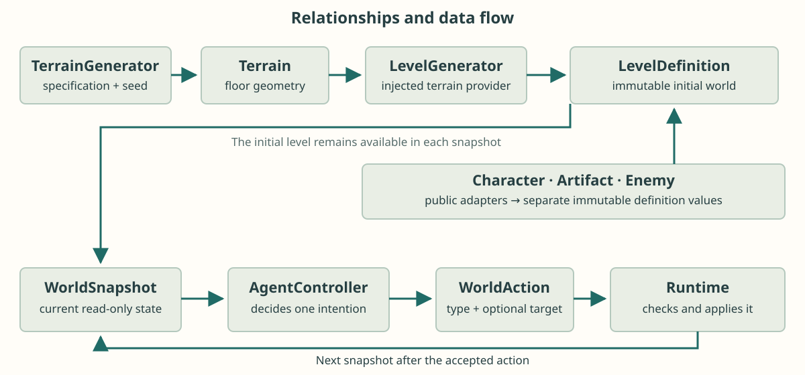
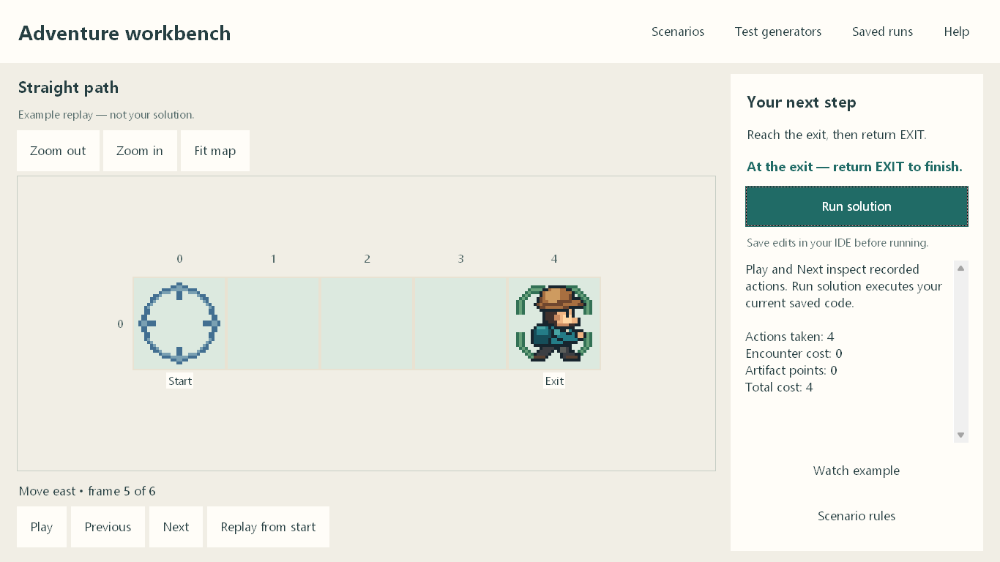
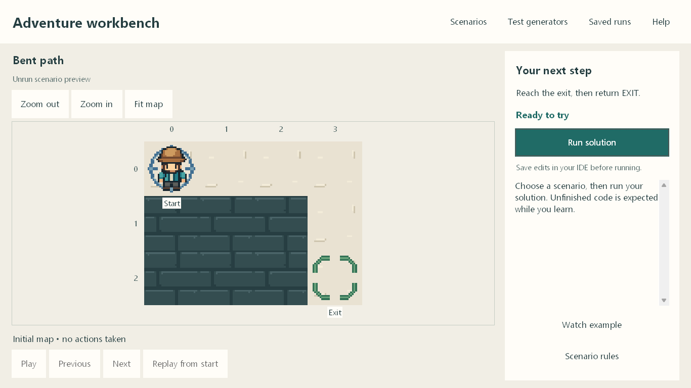
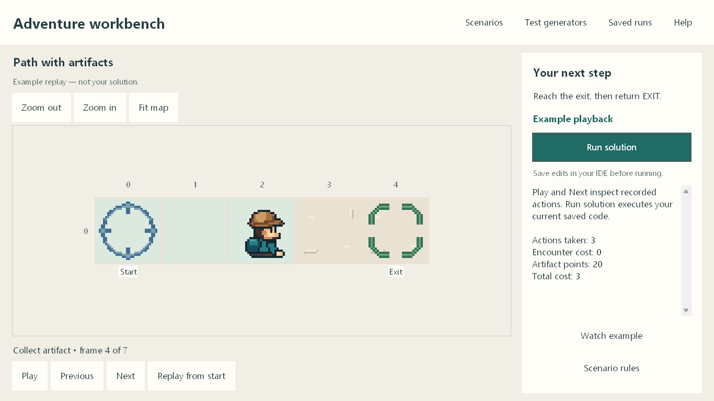
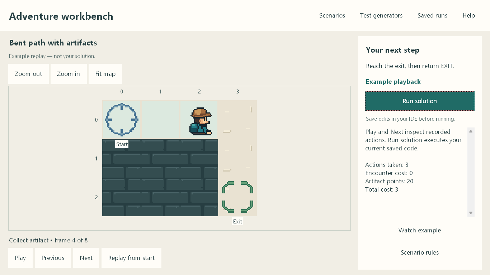
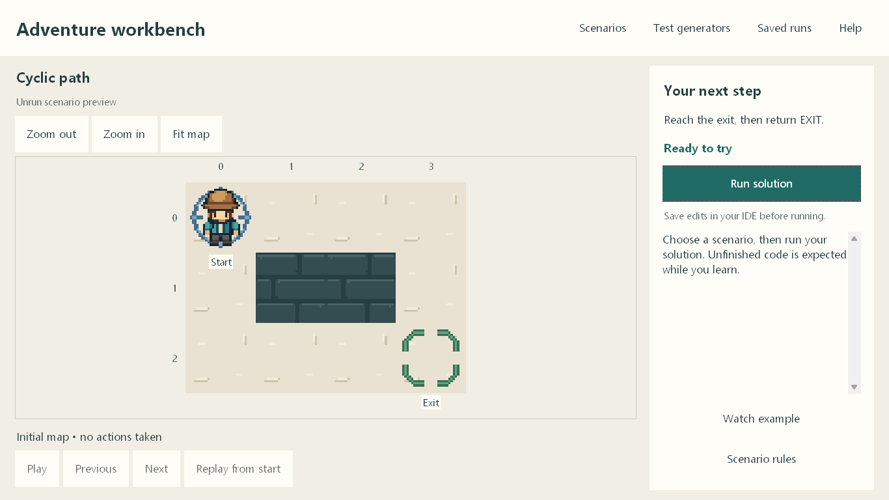
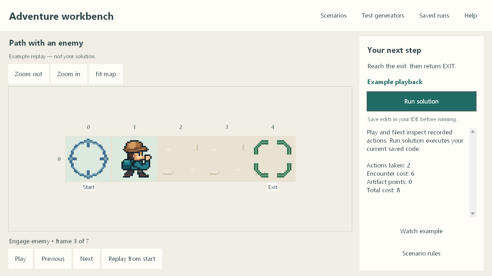
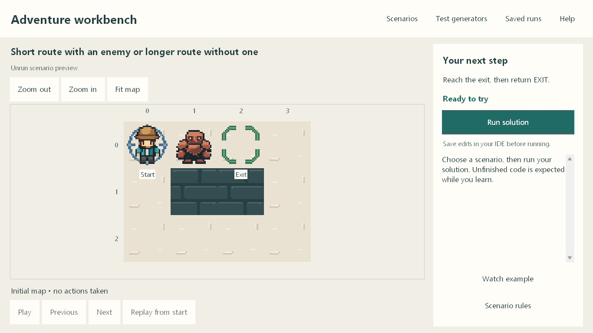

# Build an Adventure explorer

This guide assumes the Adventure workbench is open. You are building six Python components that describe objects, generate worlds, and decide what the explorer should do. The workbench supplies the map, checks your saved code, and records the result so you can inspect it one action at a time.

Start with a small responsibility. A ready-made scenario lets you work on Character and AgentController while both generators remain unfinished. Test generators separately when you are ready. Keep improving the same code as the maps become more demanding; seven separate hard-coded solutions will not handle the variations.

## Meet the objects

### Position and Terrain: where floor exists

Position is a provided value with `row` and `column`. Coordinates start at zero: the upper-left cell is Position(0, 0), and moving east increases the column. Terrain is another provided value. Its `terrain_rows` contains a rectangular tuple of strings using `.` for floor and `#` for walls. Read `rows` and `columns` to learn its size.

The opening map has five floor cells. Its actual terrain row is `.....`. The explorer starts at row 0, column 0, and the exit is at row 0, column 4. Start and exit are separate coordinates, not letters embedded in the terrain. `is_traversable(position)` checks bounds and floor geometry. It does not tell you whether an enemy currently occupies that floor cell. Your controller must consider both kinds of information before choosing a move.

### Character, Artifact, and Enemy: data with separate responsibilities

You implement Character. Its constructor receives an `agent_id`, which the required read-only property exposes. This identifies the explorer throughout the world. Character does not store the current position or perform movement. Read `state.agent_position` when deciding where the explorer is now; do not add a second authoritative position to Character.

You also implement Artifact and Enemy. An Artifact exposes `artifact_id`, `position`, and `value`. For example, a reward at Position(0, 2) can have value 20. Its identity lets an action name that particular reward. Walking onto its tile does not collect it. The runtime applies an accepted collection and records the collected ID; the Artifact does not award its own points.

An Enemy exposes `enemy_id`, `position`, and `encounter_penalty`. A static blocker with penalty 6 adds that cost when successfully engaged. Enemy does not need an attack, health, or random combat method. Keep these objects' constructor data and properties consistent. The public adapters turn your objects into separate immutable CharacterDefinition, ArtifactDefinition, and EnemyDefinition values. Those records carry initial data into the level; they do not replace your required student classes.

### The generators: geometry first, then a complete initial world

TerrainGenerator receives a TerrainGenerationSpec and a seed. You implement `generate_terrain` and return a Terrain. The specification describes dimensions, permitted floor counts, topology, and an attempt bound. For a one-row, five-column straight path with exactly five open cells, the geometry is clear. For a larger permitted shape, several different maps may be valid. The seed supports repeatable generation. TerrainGenerator receives no start or exit and should not place entities in terrain characters.

LevelGenerator receives a terrain generator through its constructor. Retain and use that supplied dependency when implementing `generate_level(specification, seed)`. LevelSpecification adds identities, entity counts and ranges, route and placement constraints, and limits. Your algorithm requests terrain, chooses valid distinct endpoints, supplies the character and required entities, and returns a LevelDefinition. It returns an initial world, never a solved route or a score. The workbench's **Provided terrain generator** option lets you check this assembly before your own terrain algorithm is ready.

### LevelDefinition and WorldSnapshot: initial world and current state

LevelDefinition is a provided immutable container. Its meaningful data includes `terrain`, `start`, `exit`, `character`, `artifacts`, and `enemies`, together with level identity and seed. Supplied advanced worlds may also contain patrol definitions. The level is the original arrangement. An artifact's initial definition remains there after collection, so the initial level alone cannot tell you everything about a later turn.

WorldSnapshot is the current read-only state passed to your controller. It contains that initial `level`, the current `agent_position`, the accepted-action count in `turn`, collected artifact IDs, defeated enemy IDs, and current enemy observations. It also exposes allowed actions and public planning values, including action limits, baseline cost, and scoring parameters. For instance, after collection the collected-ID tuple changes even though the initial artifact definition still describes where the reward was placed. Read the new snapshot on every callback instead of assuming the previous intention succeeded.

### AgentController and WorldAction: choose one intention

You implement AgentController's `choose_action(state, agent_id)`. It reads a WorldSnapshot and returns one provided WorldAction. That action holds a WorldActionType and, for a targeted action, `target_id`. Returning a string such as "east" or returning None does not satisfy this contract. The runtime validates the intention and creates the next snapshot; your controller does not move sprites or mutate authoritative state.

The controller may retain private planning data during one run, such as a route or remembered visits. A new run creates fresh component instances. Make decisions from actual coordinates and observed state so the same implementation works when endpoints or layouts change. Consult the separate [API reference](docs/guide/api-reference.html) for exact signatures and all fields as you implement each responsibility.

<figure>

<figcaption>Relationships and data flow, not class inheritance. The runtime supplies each next snapshot.</figcaption>
</figure>

## Choose, run, inspect, improve

Choose a name in **Scenarios**, then select **Run solution**. Save your source edits in your IDE first: an unsaved editor buffer is not the file the workbench can read. Unfinished components produce specific guidance. A ready-made world needs Character, AgentController, and the entity classes actually present; it does not require completed generators.

**Watch example** loads a supplied recording clearly labeled as an example. It demonstrates allowed behavior even while your own files contain TODOs. **Run solution** still tests your code. **Play**, **Previous**, **Next**, and **Replay from start** inspect recorded frames without rerunning it. Look at the action, explorer position, remaining objects, and current metrics together.

After an edit, use **Run again** to create a fresh result. Earlier recordings remain available through **Saved runs**. A code-change notice means the displayed recording belongs to earlier saved source. A slow attempt can be cancelled; wait for cleanup before starting another. A computation timeout describes a resource limit, not proof that a map has no solution.

## Know what an action does

Four cardinal moves change position by one cell when legal. **COLLECT** names an artifact on the current cell. **ENGAGE** names a static enemy on an adjacent cell; success clears that enemy but leaves the explorer where it was. **WAIT** consumes an accepted action when allowed. **EXIT** must be returned while standing on the exit. Arrival alone is not completion, and accepted EXIT also counts as an action.

The workbench shows accepted actions, artifact points, encounter cost, and total cost for the selected frame. Total cost is accepted actions plus encounter cost; an engagement penalty does not represent extra movement or elapsed turns. Final points appear at the terminal frame. Open **Help → How points work** for the selected world's complete formula and guards, and **Scenario rules** for actual requirements and limits. Playback speed changes only how quickly you view the recording.

## Seven base cases

### 1. Straight path

Given this five-cell map, the exit lies east of the start and there are no objects to manage. Choose **Straight path**. One practical approach compares the current position with the exit, chooses a legal step toward it, and checks the new snapshot on the next callback. At the exit, return EXIT.

The example shows four movements followed by one exit action. Pause on arrival: the explorer stands on the exit, but the attempt is still running. Advance once to see accepted completion. This works because each chosen movement follows the actual floor and the final intention explicitly ends the attempt. A fixed instruction to move east forever misses that last responsibility. Try reversed and vertical scenarios in the chooser to check that your decision uses coordinates instead of a memorized direction.

<figure><figcaption>Arrival is still nonterminal. The next accepted EXIT completes this example.</figcaption></figure>

### 2. Bent path

Given a path with one turn, continuing in the initial direction eventually points into a wall or outside the map. Choose **Bent path** and inspect the corner before running. One practical approach considers the traversable neighboring cells and chooses the next cell along the path, remembering enough information to avoid simply stepping backward each turn.

The path bends here, so the explorer will need to change direction before continuing toward the exit. The endpoint rule stays the same: finish with EXIT. This builds on the straight-path decision while removing the assumption that one direction works everywhere. It is reasonable to plan the simple route before moving or to choose steps from the current state; either approach must return valid individual actions. Try another orientation afterward, keeping the earlier straight-path behavior working.

<figure><figcaption>The geometry changes direction; the movement and EXIT contracts do not.</figcaption></figure>

### 3. Path with artifacts

Given a straight path with a reward on the way, choose **Path with artifacts**. The artifact at row 0, column 2 is worth 20 points. One practical approach reaches its cell, returns COLLECT with that artifact's ID, then resumes movement and exits. Check the collected IDs before deciding to collect again.

Step through the example around collection. The reward remains uncollected on arrival, even when the explorer covers its sprite. Artifact points increase after COLLECT is accepted. Collection adds one action: this example uses six accepted actions instead of the bare exit's five. With the displayed deduction of five points per excess cost unit, the extra 20-point reward improves this completed result by 15 points. Collection is optional, not a completion requirement. Try an expensive detour or smaller reward in the chooser; a reward can cost more to obtain than it contributes.

<figure><figcaption>COLLECT adds one action and 20 artifact points. Walking onto the reward did not collect it.</figcaption></figure>

### 4. Bent path with artifacts

Given a turning path with one reward, choose **Bent path with artifacts**. The navigation problem still has one simple bend. One practical approach follows the route, checks whether an uncollected artifact is on the current cell, and handles that collection before choosing the next movement. Keep navigation and object decisions coordinated so collecting does not lose your place in the route.

The example first reaches the reward, collects it, and later turns toward the exit. Its seven accepted actions include the added collection; leaving the optional reward behind needs six. This works by combining two responsibilities already tested, without changing what movement or EXIT means. Inspect the snapshot after collection rather than advancing a movement plan as though every action moved the explorer. Then try multiple artifacts in the public scenarios and check that each ID is handled independently.

<figure><figcaption>The collection changes the reward state while the explorer stays on the same cell.</figcaption></figure>

### 5. Cyclic path

Given a loop, more than one floor route can lead toward the exit. Choose **Cyclic path**. One practical approach plans a route through the floor graph and remembers the next step. Another explores while recording useful visit information. Either way, avoid repeatedly circling because the same local choice looks attractive at every turn.

The picture offers a route choice, and the example follows one route through the loop. It is a checked demonstration, not a requirement to copy that route. Revisiting a cell is legal and can be useful for backtracking or returning from a branch. The problem is an unproductive repeated decision, not the mere fact of revisiting. Compare route lengths and inspect your accepted actions. Try branches and dead ends afterward to see whether your memory supports recovery as well as forward progress.

<figure><figcaption>A useful revisit is allowed; endless traversal does not complete the world.</figcaption></figure>

### 6. Path with an enemy

Given one static blocker on the path, choose **Path with an enemy**. A traversable floor cell can still be occupied. One practical approach reaches a cell adjacent to the enemy, returns ENGAGE with its ID, checks the updated state, and then moves into the cleared cell.

Pause immediately after engagement. The enemy disappears, but the explorer has not moved. A later movement enters the cleared tile. The example's total cost is 12: four movements, one engagement, one EXIT, and an encounter cost of six. That penalty is separate from the six accepted actions; it does not advance time by six turns. Once defeated, the same static enemy should not be engaged again. Try another blocker position and confirm that your controller distinguishes adjacency from standing on a reward's collection cell.

<figure><figcaption>The enemy is cleared, but the explorer has not moved yet.</figcaption></figure>

### 7. Short route with an enemy or longer route without one

Given this loop, choose **Short route with an enemy or longer route without one**. The nearby exit has a blocker on the short route. One practical approach compares complete costs before choosing, including interactions and EXIT. Counting only movements overlooks the encounter penalty.

The direct route uses two movements, one engagement, and one EXIT: four accepted actions plus the enemy's six-unit penalty makes total cost ten. The outer route uses eight movements and EXIT, with no encounter cost, for total cost nine. The longer walk therefore costs less in this particular world. The supplied example takes that outer route. Both alternatives are legal; the comparison explains this choice without claiming that avoiding every enemy is always best. Try the public worlds with different penalties and rewards, and recompute the relevant full costs.

<figure><figcaption>Compare total cost: direct route ten; outer route nine.</figcaption></figure>

## Keep extending the same solution

Use the chooser to explore reversed endpoints, vertical paths, branches, multiple objects, overlaps, larger worlds, patrols, and mixed timed scenarios. **Public family variations** provides published seed choices. **Swap start and exit** is enabled only where that additional prepared alternative is supported. These variations belong in your continuing practice, rather than seven more separate programs.

For patrol worlds, read the complete repeating schedule, initial phase, deadline, and action-start occupancy rules in **Scenario rules**. Patrols cannot be engaged. Their positions change with accepted logical actions; accepted EXIT retains the previous patrol clock. A familiar-looking map can therefore require different timing. Look at current enemy observations as well as initial definitions.

When testing generators, use **Test generators**, select terrain or level, choose a named requirement set, and open **View selected requirements**. A terrain result contains geometry only. A valid generated level can then be run with your controller. Save a controller edit and run again to test that same generated input; generation and execution are separate steps. Switch to **My terrain generator** when you want to test the dependency between both generators.

After each change, revisit a small earlier scenario before moving to a harder one. Explain an unexpected frame in terms of its snapshot and returned action, then change the responsible component. The [API reference](docs/guide/api-reference.html) remains available when you need exact names, types, and signatures. The goal is a coherent implementation that can explain its behavior across different permitted worlds.
